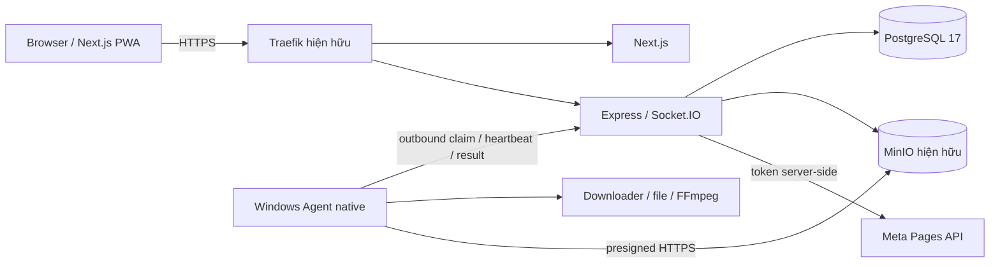

# Kiến trúc Home Automation Control Platform

## Phân tích bài toán

Sản phẩm giảm thao tác thường ngày xuống dán URL và gửi. VPS giữ cấu hình, quyền, jobs và kết quả; máy Windows tại nhà chịu download/media. Điểm khó nhất là phục hồi khi Agent offline, tránh publish trùng và xác minh quyền Meta sớm. Với một chủ sở hữu và một Agent, modular monolith + PostgreSQL đáp ứng MVP mà không cần thêm message broker.

## Kiến trúc mục tiêu

Không mở cổng vào Agent. Windows Service chạy headless; worker GUI tương lai chạy trong user session riêng. Socket mất kết nối không làm mất job vì DB là nguồn sự thật.

## Ranh giới module

| Module | Trách nhiệm | Không sở hữu |
|---|---|---|
| `frontend` | UI, PWA, trạng thái qua REST và realtime | Secret, DB, quyết định quyền |
| `backend` | Auth, device, workflow, job queue, audit, provider | Desktop/FFmpeg tại nhà |
| `agent-windows` | Worker native, claim/lease, tài nguyên local | Meta token, quyền admin |
| `packages/contracts` | Zod schema, DTO, envelope versioned | ORM, Express, React |
| `infrastructure/compose` | Stack local độc lập, migration | Thay đổi hạ tầng VPS đang dùng |

Backend dùng dependency injection để test health/DB và sau này provider/queue. Shared package biên dịch trước các consumer. Không import nội bộ giữa backend/frontend/Agent.

## Queue và publishing dự kiến

Tạo run + jobs trong SQL transaction. Claim bằng `FOR UPDATE SKIP LOCKED`, lease token và thời gian hết hạn. Chỉ holder hợp lệ được renew/complete. Unique idempotency key chống tạo job lặp. Không giữ transaction trong lúc download/upload.

Publisher ở VPS: lưu fingerprint và external state trước side effect; timeout sau upload chuyển `UNKNOWN_EXTERNAL_STATUS`, reconcile trước retry. Token Page được mã hóa tại backend, Agent chỉ nhận presigned URL giới hạn object/TTL.

## Phần khởi tạo hiện tại

- pnpm monorepo, TypeScript strict, ESLint, Vitest, CI và build từng package.
- Next.js login và dashboard yêu cầu session server-side; proxy auth cùng origin, trạng thái kết nối API/DB, manifest + icon nền PWA. Offline cache/installability đầy đủ thuộc prompt Dashboard, chưa cache dữ liệu riêng tư.
- Express `/api/v1/health/live`, `/health/ready`, envelope, request correlation, lỗi an toàn, CORS allowlist, Helmet và rate limit.
- Prisma `SystemCheck` cho integration migration, User/AuthSession/AuthThrottle/AuditLog cho auth 004, PostgreSQL 17 local Compose, Dockerfile API/FE. Các bảng nghiệp vụ khác thuộc prompt tương ứng.
- Auth dùng scrypt + session opaque hash ở PostgreSQL, CSRF/Origin, durable login throttle, owner CLI và quyền server-side; [AUTH](AUTH.md) và [ADR 001](ADR/001-admin-sessions.md). MFA mới có kế hoạch, device auth tách riêng.
- Agent có diagnose, pair/heartbeat/rotate và vòng lặp reconnect outbound; credential DPAPI CurrentUser, không listener/claim/job runner. Backend devices có pairing one-use, scoped identity, online/offline/revoke/rotation; owner UI tại /devices. [DEVICES](DEVICES.md), [ADR 002](ADR/002-device-identity.md); đã test native Windows 10, gate Windows 11 còn pending.
- Socket.IO, FFmpeg, MinIO và Meta thuộc prompt riêng; chưa kết nối service/provider thật.

## Cấu hình và dữ liệu

Env được kiểm tra bằng Zod trước khi start. Development host mặc định loopback; Compose bind process nội bộ `0.0.0.0` nhưng publish cổng trên host `127.0.0.1`. Database trong full stack không expose host; profile DB riêng phục vụ native dev chỉ bind loopback. Không có credentials mặc định cho production.

Timestamps lưu UTC; UI tương lai hiển thị `Asia/Ho_Chi_Minh` theo baseline. Secret mới đi qua `.env` không commit; `.env.example` chỉ chứa cấu hình mẫu và placeholder.

## Gates và rủi ro

| Gate | Bằng chứng yêu cầu |
|---|---|
| Bootstrap | Lint/typecheck/unit/build + runtime smoke |
| Database | Migration, readiness 200 với DB; 503 khi DB lỗi |
| Connection | Auth + pairing + queue durable + dashboard demo |
| Files | SSRF/DNS/redirect tests, checksum, timeout, disk limits |
| Facebook | Token/quyền và một bài thử trên Page được chỉ định |
| Stable 24/7 | Restart, mất mạng, backup/restore và no double publish |

Thông số VPS/domain/MinIO/Page vẫn cần chủ dự án cung cấp khi làm prompt tương ứng. Tài liệu này không xác nhận quyền Meta hoặc hạ tầng production.

## Nguồn kỹ thuật đã đối chiếu

- [Next.js installation](https://nextjs.org/docs/app/getting-started/installation) và [Next.js 16 upgrade](https://nextjs.org/docs/app/guides/upgrading/version-16): App Router và ESLint CLI riêng.
- [Prisma generators](https://www.prisma.io/docs/orm/v7/prisma-schema/overview/generators), [Prisma configuration](https://docs.prisma.io/docs/orm/reference/prisma-config-reference): generated client có output riêng, kết nối qua PostgreSQL adapter.
- [pnpm 11 release](https://pnpm.io/blog/releases/11.0): build-script allowlist dùng `allowBuilds`, settings nằm trong `pnpm-workspace.yaml`.
- [Prisma Docker guide](https://docs.prisma.io/docs/guides/deployment/docker): Debian slim cần OpenSSL cho migration engine.

Phiên bản package được pin trong manifests và lockfile; không tự chọn pre-release từ registry.
