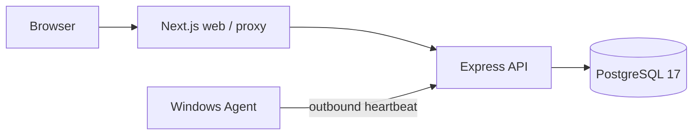

# Kiến trúc corebase

## Luồng kết nối

Browser gọi auth/device qua Next cùng origin. Next chuyển cookie/CSRF tới API. Agent gọi API trực tiếp bằng bearer riêng; PostgreSQL là nguồn dữ liệu và quyền.

| Thư mục | Trách nhiệm |
|---|---|
| `frontend/src/app/`, `frontend/src/features/` | Login, dashboard, devices, session và proxy allowlist |
| `backend/src/modules/auth/` | Password, session, CSRF, throttle, CLI tạo tài khoản |
| `backend/src/modules/devices/` | Pair, heartbeat, owner/member, revoke, runtime/activity |
| `backend/prisma/` | Schema và migrations |
| `agent-windows/src/core/` | CLI, HTTP client, reconnect, rotation, kho DPAPI |
| `packages/contracts/` | Zod schemas và DTO chung |
| `infrastructure/compose/`, `infrastructure/vps/` | Local DB/stack và VPS HTTPS |

## Quyền và vòng đời kết nối

1. `owner:bootstrap` tạo tài khoản đầu tiên; `user:create` thêm user. Session hết hạn sau 30 phút, gia hạn tối đa 8 giờ từ login.
2. User tạo mã pair 5 phút/dùng một lần. Agent xác nhận URL + nhập mã, lưu credential DPAPI CurrentUser; DB chỉ lưu hash.
3. Agent heartbeat 5 giây và gửi hostname, uptime, RAM, CPU count. Lỗi mạng retry bằng backoff; credential lỗi thì dừng.
4. Web lấy snapshot mỗi 5 giây. ONLINE cần heartbeat trong 25 giây, credential còn hạn và heartbeat sau lần start API. API restart phải chờ heartbeat mới.
5. Web mất server/phiên thì xóa snapshot, báo unknown. OFFLINE chỉ được suy ra khi server vẫn trả snapshot hợp lệ.
6. Owner/member xem máy; chỉ owner device chia sẻ/revoke. VIEWER/OPERATOR hiện chỉ xem. Global OWNER không có quyền ngầm với device khác.
7. Credential TTL 24 giờ, tự rotate khi còn dưới 6 giờ. Offline quá hạn cần revoke/pair lại. Revoke vô hiệu cả active/pending token.

## Địa chỉ

| Kết nối | Local mặc định | VPS |
|---|---|---|
| Browser → web | `http://localhost:3000` | `https://<domain>` |
| Next → API | `http://localhost:4000/api/v1` | `http://backend:4000/api/v1` trong Docker |
| Windows Agent → API | `http://localhost:4000/api/v1` | `https://<domain>/api/v1` |
| API → DB | `localhost:5432` | `postgres:5432` trong mạng riêng |

VPS proxy `/api/v1/agent/*`, `/api/v1/health/*` tới backend; các route còn lại tới Next. Local dùng cùng `localhost` cho URL web và Origin; không trộn `127.0.0.1`. Chạy một backend instance.

Hiện chưa có lease, executor, desktop, queue/publish hoặc Windows Service. Theo [CORE_ROADMAP](CORE_ROADMAP.md) khi phát triển tiếp; thiết kế cũ nằm trong [archive](archive/automation-baseline.md). Bắt đầu chạy tại [start-here](guides/start-here.md).
