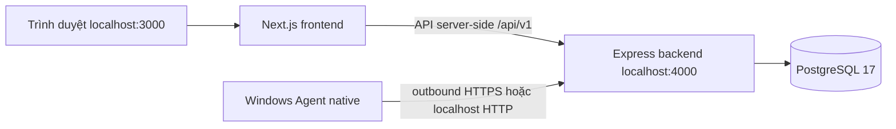

# Hướng dẫn sử dụng dự án

**Người mới bắt đầu tại [Bắt đầu từng bước](start-here.md)**. Sau khi local chạy được, xem [Thiết lập VPS HTTPS](vps-setup.md). [Lộ trình mới](../CORE_ROADMAP.md) giải thích phần giữ lại/chuyển đổi từ starter và các bước điều khiển sau core giám sát.

Bộ guide này mô tả **những kết nối đang chạy được ở local**. Bắt đầu với [bài thực hành từ đầu](start-here.md) hoặc [thiết lập local](local-setup.md), sau đó xem [cấu trúc dự án](project-structure.md), [cấu hình](configuration.md), [luồng kết nối](connections.md) và [kiểm tra, xử lý lỗi](verification.md).

| Mục đích | Tài liệu |
|---|---|
| Chọn cách chạy, cài đặt và tạo owner | [Thiết lập local](local-setup.md) |
| Biết sửa FE, BE, Agent, contract và migration ở đâu | [Cấu trúc dự án](project-structure.md) |
| Hiểu từng file `.env`, URL và port | [Cấu hình](configuration.md) |
| Hiểu Browser → FE → BE → DB và Agent → BE | [Luồng kết nối](connections.md) |
| Kiểm tra health, đăng nhập, pairing và lỗi thường gặp | [Kiểm tra, xử lý lỗi](verification.md) |

Hiện có login/session, owner/member theo device, health, pairing, heartbeat 5s, runtime aggregate và lịch sử hoạt động. Agent chưa chạy job tải file hay publish; queue, Socket.IO, MinIO, Meta và triển khai production nằm trong các prompt sau. Kiểm thử thực tế trên Windows 11 của prompt 005 vẫn đang chờ; xem [DEVICES](../DEVICES.md) và [prompt đang xử lý](../processing/005-agent-pairing.md).

Tài liệu chi tiết và quyết định kỹ thuật: [kiến trúc](../ARCHITECTURE.md), [API](../API.md), [auth](../AUTH.md), [database](../DATABASE.md), [Windows Agent](../DEVICES.md), [vận hành](../OPERATIONS.md). [README gốc](../../README.md) ghi trạng thái và lệnh ngắn gọn.
