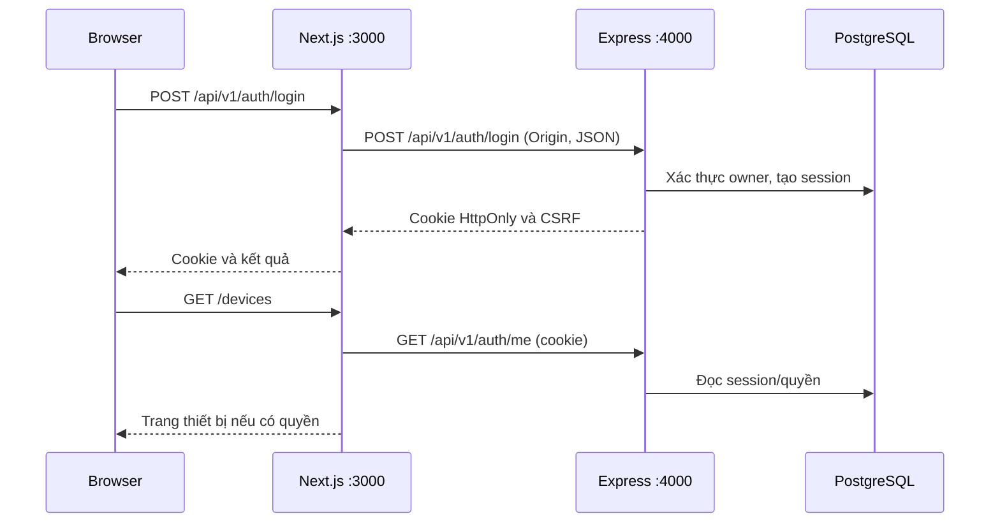
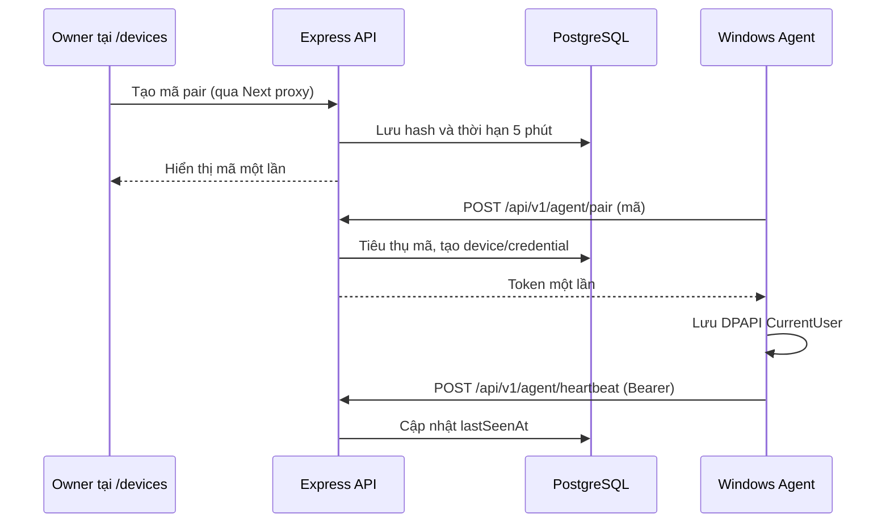

# Luồng kết nối hiện tại

Core 021 mở quyền xem cho owner/member theo từng device; user đăng nhập được tạo mã cho máy mình. FE lấy snapshot REST mỗi 5 giây, Agent heartbeat 5 giây, offline sau 25 giây không liên lạc. Mất server hoặc phiên đăng nhập làm FE xóa snapshot và báo unknown. Không có WebSocket/lease/desktop trong bước này. [Lộ trình](../CORE_ROADMAP.md).

## Đăng nhập và quản lý thiết bị

Browser dùng route Next.js cùng origin `/api/v1/auth/{action}` và `/api/v1/devices/...`. Next chỉ proxy các path/method được cho phép, chuyển cookie phiên và header CSRF cần thiết; BE kiểm tra session, Origin và quyền OWNER ở server. Các mutation cần `Origin`, JSON và `X-CSRF-Token` khi đã đăng nhập. Đừng gọi BE trực tiếp từ một origin khác và mong cookie frontend tự hoạt động. Server-side render của Next gọi `API_INTERNAL_BASE_URL` để đọc session/health; khi thiếu biến này mới dùng `NEXT_PUBLIC_API_BASE_URL` làm fallback.

`FRONTEND_ORIGIN` ở BE, `AUTH_FRONTEND_ORIGIN` ở FE và địa chỉ mở trên browser phải khớp **scheme + hostname + port**. Với mặc định, dùng `http://localhost:3000` cho cả ba. `NEXT_PUBLIC_API_BASE_URL` là địa chỉ mà host/trình duyệt có thể tới; `API_INTERNAL_BASE_URL` trong Compose là tên service Docker `backend`, không dùng URL này trong trình duyệt. FE không biết mật khẩu DB và không truy cập PostgreSQL trực tiếp.

## Agent ghép đôi và heartbeat

Agent gọi BE **trực tiếp**, không qua FE và không dùng cookie admin. API phân biệt bearer credential của device với session admin. Agent chỉ mở kết nối outbound; `start` hiện chỉ heartbeat/reconnect và tự xoay credential khi gần hết hạn. Owner revoke từ `/devices`; Agent bị revoke dừng khi nhận lỗi xác thực. Xem [DEVICES](../DEVICES.md) cho TTL, rotate và recovery.

## Health và địa chỉ theo cách chạy

| Thành phần | Native + DB Docker | Full stack Docker |
|---|---|---|
| Browser → FE | `http://localhost:3000` | `http://localhost:3000` (hoặc `FRONTEND_PORT`) |
| Host/Agent cùng máy → BE | `http://localhost:4000/api/v1` | `http://localhost:4000/api/v1` (hoặc `BACKEND_PORT`) |
| Next server → BE | `http://localhost:4000/api/v1` | `http://backend:4000/api/v1` |
| BE → DB | `localhost:5432` (hoặc `POSTGRES_DEV_PORT`) | `postgres:5432` |

`GET /api/v1/health/live` xác nhận tiến trình BE đang chạy; `GET /api/v1/health/ready` kiểm tra BE kết nối được DB và trả 503 nếu DB không sẵn sàng. Health không chứng minh migration/owner/pairing đã thành công. Xem [kiểm tra và xử lý lỗi](verification.md).
